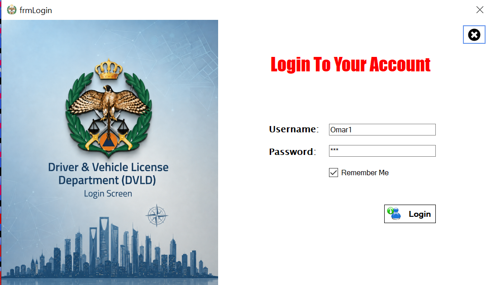

  

# DVLD – Driving & Vehicle License Management System

A desktop application designed to manage driving license operations and services, simulating the workflow of a real Driving License Department.

The project was developed using **C#, Windows Forms, SQL Server, and 3-Tier Architecture**, with a focus on code organization, separation of concerns, and database interaction.

---

# ⚠️ VERY IMPORTANT – READ BEFORE RUNNING THE PROJECT

**The application will NOT work correctly until you complete the following steps.**

### 1. Restore the Database

You must restore the provided SQL Server database backup (`.bak`) to the SQL Server instance installed on your computer before running the application.

Make sure the database name after restoration matches the name used in the Connection String.

### 2. Update the Connection String

After restoring the database, you must update the server name in the following file:

`DVLD - DataAccessLayer/clsDataAccessSettings.cs`

Find the Connection String containing:

```
Server=ox101
```

**Replace** `**ox101**` **with your own computer name (or your SQL Server instance name).**

For example, if your computer name is `DESKTOP-ABC123`, update the line to:

```
Server=DESKTOP-ABC123
```

> **Note:** `ox101` is my personal computer name. Therefore, the database connection will fail on your computer unless your SQL Server instance uses the same name.

**Skipping either of the two steps above will cause the application to fail to connect to the database.**

---

## Project Overview

DVLD is a Driving and Vehicle License Department Management System that provides an organized environment for handling driving license services, applications, and related operations.

The project follows the **3-Tier Architecture** to separate the user interface from business logic and data access operations.

## Architecture

The application is divided into three main layers:

|Layer|Responsibility|
|---|---|
|Presentation Layer|Handles the user interface and user interactions using Windows Forms.|
|Business Layer|Contains business logic, data validation, and application rules.|
|Data Access Layer|Handles database operations and communication with SQL Server.|

This separation makes the application easier to maintain, extend, and debug.

## Technologies Used

- **C#** – The primary programming language.
    
- **.NET Framework** – The framework used to develop the application.
    
- **Windows Forms (WinForms)** – Used to build the desktop application interface.
    
- **Microsoft SQL Server** – Relational database management system.
    
- **ADO.NET** – Used for database connectivity and data operations.
    
- **3-Tier Architecture** – Separates application responsibilities into independent layers.
    

## Main Features

- People Management.
    
- User Management.
    
- Driving License Application Management.
    
- Local Driving License Management.
    
- International Driving License Management.
    
- Driving Tests Management.
    
- Issuing and renewing driving licenses.
    
- Handling various operations and managing data through the database.
    

## Getting Started

To run the project on your computer, follow these steps:

1. Download the project or clone the repository.
    
2. Restore the provided database backup using SQL Server Management Studio (SSMS).
    
3. Update the Connection String in `clsDataAccessSettings.cs`.
    
4. Open the `.sln` solution file using Visual Studio.
    
5. Build the solution.
    
6. Run the application.

## Screenshots

### Login


### Main Dashboard


### Main Dashboard 2


### People Management


### Users & Add New User


### Applications License Management


## Project Structure

```
DVLD/
│
├── Driver & Vehicle License Department (DVLD)/
│   └── Presentation Layer
│
├── DVLD - BusinessLayer/
│   └── Business Layer
│
├── DVLD - DataAccessLayer/
│   └── Data Access Layer
│
└── UserControles/
    └── Reusable UI Controls
```

## Author

**Aly Amer**

DotNet Developer | C# | ADO.NET | SQL Server

GitHub: [AlyAmer101](https://github.com/AlyAmer101)

Linkedin: [Aly Amer](https://www.linkedin.com/in/eng-aly-amer/)

---

This project was developed as part of the ProgrammingAdvices learning roadmap, with the goal of applying software development concepts in practice through a complete project that simulates a real-world system.
